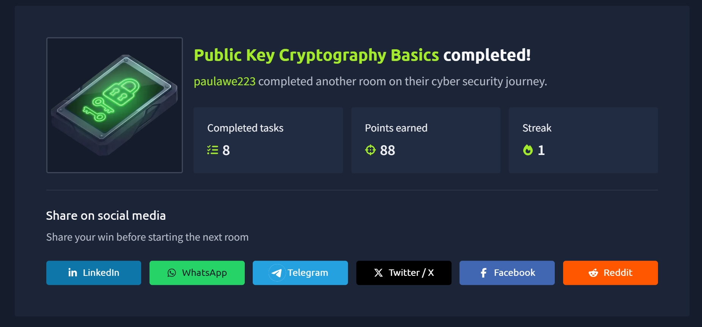

# 🔐 TryHackMe Cyber Security 101 — Public Key Cryptography Basics

**Room:** Public Key Cryptography Basics  
**Platform:** TryHackMe  
**Learning Path:** Cyber Security 101  
**Module:** Cryptography  
**Status:** ✅ Completed  

---

## 📖 Introduction

In this room, I explored the fundamentals of **Public Key Cryptography**, also known as **Asymmetric Cryptography**, and how it helps secure digital communications.

Building on the Cryptography Basics room, I learned how public and private keys work together to provide secure communication, authentication, data integrity, and confidentiality.

I also studied several important cryptographic technologies, including RSA, Diffie-Hellman Key Exchange, SSH, digital signatures, SSL/TLS certificates, and PGP/GPG.

These technologies are essential to cybersecurity because they protect sensitive information transmitted across potentially insecure networks.

### 🎯 Learning Objectives

By completing this room, I aimed to understand:

- The difference between symmetric and asymmetric cryptography.
- How public and private keys work.
- The mathematical foundations of RSA encryption.
- How Diffie-Hellman establishes shared secret keys.
- How SSH uses public key cryptography for authentication.
- How digital signatures protect authenticity and integrity.
- How SSL/TLS certificates establish trust.
- How PGP and GPG secure files and email communications.
- The importance of protecting private cryptographic keys.

---

## 1. 🔒 Security Principles in Cryptography

Cryptography helps protect communication against unauthorized access, modification, and impersonation.

Four important security concepts covered in this room were:

| Principle | Description |
|---|---|
| Authentication | Verifying the identity of the person or system communicating. |
| Authenticity | Confirming that information genuinely originates from its claimed sender. |
| Integrity | Ensuring that information has not been modified or tampered with. |
| Confidentiality | Ensuring that only authorized individuals can access information. |

### Practical Example

Imagine two business partners discussing confidential information over the internet.

They need to ensure that:

1. They are communicating with the correct person.
2. Messages genuinely come from the expected sender.
3. Messages are not modified during transmission.
4. Unauthorized individuals cannot read their conversations.

Cryptography provides mechanisms for addressing these requirements.

### Key Takeaway

Encryption primarily protects confidentiality, while mechanisms such as digital signatures and certificates help establish authenticity, integrity, and identity.

---

## 2. 🔑 Symmetric vs. Asymmetric Cryptography

Two major approaches to cryptography are symmetric and asymmetric cryptography.

### Symmetric Cryptography

Symmetric cryptography uses the same secret key for encryption and decryption.

For example:

```text
Original Message
       |
       v
Encryption + Secret Key
       |
       v
Encrypted Message
       |
       v
Decryption + Same Secret Key
       |
       v
Original Message
```

**Advantages:**
- Fast and efficient.
- Suitable for encrypting large amounts of data.
- Commonly used for ongoing secure communication.

**Disadvantage:**
- Both communicating parties must securely obtain the same secret key.

### Asymmetric Cryptography

Asymmetric cryptography uses two mathematically related keys:

- **Public Key:** Can be shared openly.
- **Private Key:** Must remain secret.

For public-key encryption:

```text
Sender
   |
   v
Recipient's Public Key
   |
   v
Encrypt Message
   |
   v
Encrypted Message
   |
   v
Recipient's Private Key
   |
   v
Decrypt Message
```

Only the intended recipient should possess the corresponding private key.

### Comparison

| Feature | Symmetric | Asymmetric |
|---|---|---|
| Keys | One shared secret key | Public/private key pair |
| Speed | Generally faster | Generally slower |
| Key distribution | Requires secure key sharing | Public keys can be distributed openly |
| Common uses | Bulk data encryption | Authentication, signatures, key establishment |
| Examples | AES | RSA, elliptic-curve cryptography |

### Why Both Are Used Together

Asymmetric operations are generally more computationally expensive than symmetric encryption.

Consequently, many secure communication protocols combine both approaches.

For example:

1. Asymmetric cryptographic mechanisms help authenticate parties and establish shared secrets.
2. A symmetric session key is derived or established.
3. Symmetric encryption protects the ongoing communication.

This approach combines secure key establishment with efficient data encryption.

---

## 3. 🔐 RSA Encryption

RSA is a widely known public-key cryptographic algorithm.

Its security relies on the mathematical difficulty of factoring sufficiently large numbers formed by multiplying large prime numbers.

### Understanding Prime Factorization

A prime number is a number greater than 1 that has exactly two positive factors: 1 and itself.

Examples include:

```text
2, 3, 5, 7, 11, 13, 17, 19
```

Multiplying two prime numbers is straightforward.

For example:

```text
113 × 127 = 14,351
```

However, determining the original prime factors of a sufficiently large number can be computationally difficult.

RSA uses this mathematical property to help secure cryptographic operations.

### Important RSA Variables

| Variable | Meaning |
|---|---|
| p | First prime number |
| q | Second prime number |
| n | Product of p and q |
| e | Public exponent |
| d | Private exponent |
| m | Original message or plaintext |
| c | Encrypted message or ciphertext |

### RSA Key Generation

The basic process involves:

1. Selecting two prime numbers, `p` and `q`.
2. Calculating `n = p × q`.
3. Calculating Euler's totient, `φ(n)`.
4. Selecting a suitable public exponent `e`.
5. Calculating the corresponding private exponent `d`.

The resulting keys are:

```text
Public Key  = (n, e)
Private Key = (n, d)
```

### RSA Numerical Example

The room demonstrated RSA using:

```text
p = 157
q = 199
```

Calculate:

```text
n = p × q

n = 157 × 199

n = 31,243
```

Next:

```text
φ(n) = (p - 1)(q - 1)

φ(n) = 156 × 198

φ(n) = 30,888
```

The chosen public exponent is:

```text
e = 163
```

The private exponent is:

```text
d = 379
```

These values satisfy:

```text
(e × d) mod φ(n) = 1

(163 × 379) mod 30,888 = 1
```

Therefore:

```text
Public Key  = (31243, 163)
Private Key = (31243, 379)
```

### RSA Encryption

Suppose Alice wants to encrypt the number:

```text
m = 13
```

The RSA encryption formula is:

```text
c = m^e mod n
```

Substituting:

```text
c = 13^163 mod 31243

c = 16341
```

Alice sends the encrypted value:

```text
16341
```

### RSA Decryption

Bob uses his private key to decrypt the ciphertext.

The formula is:

```text
m = c^d mod n
```

Substituting:

```text
m = 16341^379 mod 31243

m = 13
```

Bob successfully recovers the original message.

**Important:** These numbers are intentionally small for learning purposes and are not secure for real-world encryption.

Real RSA implementations require appropriately sized keys, secure padding schemes, and trusted cryptographic libraries.

---

## 4. 🧮 Understanding Modular Arithmetic

Modular arithmetic plays an important role in RSA and Diffie-Hellman.

The modulo operation returns the remainder after division.

For example:

```text
17 mod 5 = 2
```

Because:

```text
17 = (5 × 3) + 2
```

The remainder is 2.

Another example:

```text
81 mod 29 = 23
```

Because:

```text
81 = (29 × 2) + 23
```

### Why Modular Arithmetic Matters

Cryptographic algorithms often work with very large numbers.

Modular arithmetic allows calculations to be performed while keeping intermediate values manageable.

For example:

```text
3^13 mod 29
```

First, calculate:

```text
3^13 = 1,594,323
```

Then:

```text
1,594,323 mod 29 = 19
```

Therefore:

```text
3^13 mod 29 = 19
```

This calculation also appears in the Diffie-Hellman example below.

---

## 5. 🔄 Diffie-Hellman Key Exchange

Diffie-Hellman is a cryptographic key agreement method that allows two parties to establish a shared secret over an insecure communication channel.

The important concept is that the communicating parties can establish the same shared secret without directly transmitting that secret.

### The Key Exchange Problem

Imagine Alice and Bob want to communicate using symmetric encryption.

They need the same secret key.

However, sending that secret key directly over an insecure network could expose it to an attacker.

Diffie-Hellman provides a solution.

### Diffie-Hellman Numerical Example

Alice and Bob agree on two public values:

```text
Prime number (p) = 29

Generator (g) = 3
```

These values can be shared publicly.

They independently select private values.

```text
Alice's private key (a) = 13

Bob's private key (b) = 15
```

### Step 1: Alice Calculates Her Public Key

Formula:

```text
A = g^a mod p
```

Substitute:

```text
A = 3^13 mod 29

A = 19
```

Alice's public key is:

```text
19
```

### Step 2: Bob Calculates His Public Key

Formula:

```text
B = g^b mod p
```

Substitute:

```text
B = 3^15 mod 29

B = 26
```

Bob's public key is:

```text
26
```

### Step 3: Exchange Public Keys

Alice sends:

```text
A = 19
```

Bob sends:

```text
B = 26
```

Their private values are never transmitted.

### Step 4: Alice Calculates the Shared Secret

Alice uses Bob's public key and her private key.

```text
Shared Secret = B^a mod p

Shared Secret = 26^13 mod 29

Shared Secret = 10
```

### Step 5: Bob Calculates the Shared Secret

Bob uses Alice's public key and his private key.

```text
Shared Secret = A^b mod p

Shared Secret = 19^15 mod 29

Shared Secret = 10
```

Both calculations produce:

```text
Shared Secret = 10
```

### Result

```text
Alice                         Bob

Private Key: 13               Private Key: 15
Public Key: 19                Public Key: 26

       Exchange Public Keys
                |
                v
     Calculate Shared Secret
                |
                v
       Shared Secret = 10
```

Alice and Bob now possess the same shared secret.

In real implementations, the resulting shared secret is normally processed through a key derivation function to produce usable symmetric encryption keys.

### Security Considerations

- Private keys must remain secret.
- Real implementations require sufficiently strong cryptographic parameters.
- Diffie-Hellman alone does not authenticate the communicating parties.
- Without authentication, it can be vulnerable to man-in-the-middle attacks.

### Key Takeaway

Diffie-Hellman allows two parties to establish a shared secret without sending the secret itself across the network.

---

## 6. 💻 SSH and Public Key Authentication

SSH stands for **Secure Shell**.

It is a network protocol used for secure remote access and communication.

SSH uses cryptographic mechanisms to protect connections between clients and servers.

### Authenticating the SSH Server

When connecting to an SSH server for the first time, a user may receive a message similar to:

```bash
ssh 10.10.244.173
```

Example output:

```text
The authenticity of host '10.10.244.173'
can't be established.

ED25519 key fingerprint is SHA256:...

Are you sure you want to continue connecting
(yes/no/[fingerprint])?
```

This message appears because the SSH client has not previously trusted the server's host key.

The user should verify the server's fingerprint through a trusted source before accepting it.

Once accepted, the server's host key is recorded in the local `known_hosts` file.

Future connections can be checked against the stored key.

An unexpected host key change may indicate a legitimate server change or a possible security threat.

### SSH Client Authentication

SSH supports multiple authentication methods, including:

- Password authentication.
- Public key authentication.

Public key authentication uses a cryptographic key pair to prove that a client possesses an authorized private key.

### Generating SSH Keys

The room demonstrated generating an Ed25519 key pair using:

```bash
ssh-keygen -t ed25519
```

The command creates two files by default:

```text
id_ed25519
id_ed25519.pub
```

| File | Purpose |
|---|---|
| id_ed25519 | Private key |
| id_ed25519.pub | Public key |

The private key must remain confidential.

The public key can be copied to systems where the user is authorized to authenticate.

### Viewing the Public Key

```bash
cat ~/.ssh/id_ed25519.pub
```

The public key begins with an identifier such as:

```text
ssh-ed25519 AAAA...
```

### Important SSH Key Algorithms

| Algorithm | Description |
|---|---|
| RSA | Public-key algorithm used for encryption and digital signatures |
| DSA | Digital Signature Algorithm |
| ECDSA | Elliptic Curve Digital Signature Algorithm |
| ECDSA-SK | Hardware security key-backed ECDSA |
| Ed25519 | Modern elliptic-curve digital signature algorithm |
| Ed25519-SK | Hardware security key-backed Ed25519 |

Ed25519 is commonly used for modern SSH authentication.

---

## 7. 🛡️ Protecting SSH Private Keys

One of the most important lessons from this room was the need to protect private keys.

A private key should be treated like a highly sensitive password.

If an attacker obtains an unprotected private key, they may be able to authenticate to systems that trust its corresponding public key.

### Private Key Protection

Recommended practices include:

- Never share private keys.
- Use strong passphrases.
- Store keys securely.
- Restrict file permissions.
- Remove keys that are no longer needed.
- Avoid uploading private keys to public repositories.

### Setting SSH Key Permissions

On Linux, private key permissions should restrict access to the owner.

```bash
chmod 600 ~/.ssh/id_ed25519
```

This grants the owner read and write permissions while denying access to other users.

### Connecting With a Private Key

```bash
ssh -i ~/.ssh/id_ed25519 user@host
```

Explanation:

| Component | Purpose |
|---|---|
| ssh | Starts an SSH connection |
| -i | Specifies the identity/private key file |
| ~/.ssh/id_ed25519 | Path to the private key |
| user@host | Remote username and server |

### Copying a Public Key to a Server

```bash
ssh-copy-id user@host
```

This command helps install the user's public key on a remote server.

### Authorized Keys

SSH servers commonly store trusted client public keys in:

```text
~/.ssh/authorized_keys
```

If a user's public key is listed there, and the SSH server permits public key authentication, the user can authenticate by proving possession of the corresponding private key.

### Security Note

An attacker who can modify an account's `authorized_keys` file may add an unauthorized public key to maintain access.

For defenders, unexpected changes to this file can indicate persistence or unauthorized account access.

---

## 8. ✍️ Digital Signatures

Digital signatures provide a cryptographic way to verify the authenticity and integrity of digital information.

They help answer two important questions:

1. Did this information originate from the expected signer?
2. Has the information changed since it was signed?

### How Digital Signatures Work

A simplified digital signature process involves:

1. Creating a cryptographic hash of a message.
2. Signing the hash using the sender's private key.
3. Sending the message and digital signature.
4. Verifying the signature using the sender's public key.

```text
Sender
   |
   v
Original Document
   |
   v
Generate Hash
   |
   v
Sign Using Private Key
   |
   v
Digital Signature
   |
   v
Recipient Verifies Using Public Key
   |
   v
Signature Valid / Invalid
```

If verification succeeds, the recipient has evidence that the signed content has not been altered and that the signature was generated using the corresponding private key.

The recipient must also establish that the public key belongs to the expected signer.

### Digital vs. Electronic Signatures

A picture of a handwritten signature pasted onto a document does not provide cryptographic integrity protection.

A cryptographic digital signature can detect unauthorized changes to signed information.

### Practical Applications

Digital signatures are used in:

- Software distribution.
- Signed documents.
- Secure email.
- Software updates.
- Certificate validation.
- Code signing.

### Key Takeaway

Digital signatures provide authenticity and integrity verification, but they do not encrypt the message or automatically provide confidentiality.

---

## 9. 🌐 SSL/TLS Certificates

TLS stands for **Transport Layer Security**.

It is a cryptographic protocol used to protect communications across networks.

HTTPS uses TLS to secure communication between web browsers and web servers.

### Why Certificates Are Important

Imagine visiting:

```text
https://tryhackme.com
```

How does your browser determine whether it is communicating with the legitimate website?

TLS certificates help establish the identity of the server.

### Certificate Authorities

A Certificate Authority (CA) is an organization trusted to issue and sign digital certificates.

Browsers and operating systems maintain stores of trusted root certificates.

A simplified chain of trust looks like:

```text
Trusted Root CA
       |
       v
Intermediate CA
       |
       v
Website Certificate
       |
       v
Browser Validates Certificate
```

The browser checks whether the certificate is valid and trusted for the requested website.

### Certificate Validation

Certificate validation commonly includes checking:

- The certificate's domain name.
- Its validity period.
- Its digital signature.
- Its chain of trust.
- Relevant certificate restrictions and revocation information.

### Let's Encrypt

Let's Encrypt is a Certificate Authority that provides free TLS certificates.

Website administrators can use these certificates to enable HTTPS.

### Key Takeaway

TLS certificates help browsers authenticate websites and establish trusted, encrypted communication.

---

## 10. 📧 PGP and GPG

PGP stands for **Pretty Good Privacy**.

It provides cryptographic capabilities for protecting messages and files.

GPG stands for **GNU Privacy Guard**.

GPG is an open-source implementation of the OpenPGP standard.

### Common Uses

PGP and GPG can be used for:

- Encrypting email messages.
- Encrypting files.
- Creating digital signatures.
- Verifying signed information.
- Protecting confidential communication.

### How GPG Encryption Works

Suppose Alice wants to send Bob a confidential message.

1. Bob generates a public/private key pair.
2. Bob shares his public key with Alice.
3. Alice encrypts the message using Bob's public key.
4. Bob decrypts the message using his private key.

```text
Alice                         Bob

Message
   |
   v
Bob's Public Key
   |
   v
Encrypted Message ----------> Private Key
                                  |
                                  v
                           Original Message
```

Only someone with the appropriate private key should be able to decrypt the protected message.

---

## 11. 🔧 Generating GPG Keys

The room introduced the following command:

```bash
gpg --full-gen-key
```

This launches an interactive process for generating a GPG key pair.

During key generation, the user may be prompted to select:

- Cryptographic algorithm.
- Key type.
- Key expiration period.
- Real name.
- Email address.
- Optional comments.
- Key protection settings.

### Example Algorithm Selection

The room demonstrated selecting:

```text
ECC (sign and encrypt)
```

Using:

```text
Curve 25519
```

### Useful GPG Commands

| Command | Purpose |
|---|---|
| `gpg --full-gen-key` | Generate a new key pair |
| `gpg --list-keys` | List available public keys |
| `gpg --list-secret-keys` | List private keys |
| `gpg --import backup.key` | Import a saved key |
| `gpg --decrypt file.gpg` | Decrypt an encrypted file |

### Importing a Key

```bash
gpg --import backup.key
```

This imports key material from a backup file.

### Decrypting a Message

```bash
gpg --decrypt confidential_message.gpg
```

This attempts to decrypt the specified encrypted message using an available matching private key.

### Important Security Practices

- Protect private keys with strong passphrases.
- Store private key backups securely.
- Verify the authenticity of imported public keys.
- Avoid exposing private keys in public repositories.
- Revoke compromised keys when necessary.

---

## 12. 🚩 Cryptography in Capture The Flag Challenges

Cryptography frequently appears in cybersecurity Capture The Flag (CTF) challenges.

These challenges may involve:

- Identifying cryptographic algorithms.
- Understanding RSA parameters.
- Performing modular arithmetic.
- Recovering plaintext from intentionally weak encryption.
- Decrypting protected files.
- Working with public and private key formats.

### RSA in CTF Challenges

RSA challenges may provide values such as:

```text
p
q
n
e
d
c
```

The goal may be to calculate missing values or decrypt a message.

For example, if the prime factors `p` and `q` are known, the participant may be able to derive the private exponent and decrypt the provided ciphertext.

### Tools Mentioned in the Room

**RsaCtfTool**

A tool used for solving RSA-related cryptographic challenges.

**rsatool**

A utility that can assist with RSA key calculations.

**John the Ripper**

A password auditing tool that can be used to test the strength of passphrases protecting cryptographic keys.

**gpg2john**

A utility that converts certain GPG-protected key material into a format suitable for authorized password auditing with John the Ripper.

These tools are useful in authorized labs, CTF environments, and security assessments.

---

## 13. 🔍 Cryptography vs. Cryptanalysis

The room concluded by distinguishing cryptography from cryptanalysis.

### Cryptography

Cryptography is the science of protecting communication and information using cryptographic techniques.

Its objectives include:

- Confidentiality.
- Integrity.
- Authentication.
- Authenticity.

### Cryptanalysis

Cryptanalysis is the study of techniques used to analyze, break, or bypass cryptographic protections.

Cryptanalysis helps researchers understand weaknesses in cryptographic algorithms and implementations.

### Brute-Force Attacks

A brute-force attack systematically tries possible keys or passwords until a match is found.

For example:

```text
0000
0001
0002
0003
...
9999
```

The effectiveness of brute-force attacks depends on factors such as key space size, password complexity, and computational resources.

### Dictionary Attacks

A dictionary attack tests likely passwords from predefined wordlists.

For example:

```text
password
welcome
admin123
football
```

Dictionary attacks rely on the assumption that users may choose predictable passwords.

### Comparison

| Concept | Meaning |
|---|---|
| Cryptography | Protecting information using cryptographic methods |
| Cryptanalysis | Studying weaknesses in cryptographic protections |
| Brute Force | Systematically testing possible combinations |
| Dictionary Attack | Testing likely passwords from wordlists |

---

## 14. 🧠 Key Lessons Learned

After completing this room, I gained a stronger understanding of how public key cryptography supports modern cybersecurity.

My major takeaways include:

1. **Public and private keys serve different purposes.** Public keys can be distributed openly, while private keys must remain confidential.

2. **RSA relies on mathematical properties.** Its security depends on the difficulty of factoring appropriately sized large composite numbers.

3. **Modular arithmetic is fundamental to cryptography.** Operations involving remainders are central to RSA and Diffie-Hellman.

4. **Diffie-Hellman enables shared secret establishment.** Two parties can derive the same secret without transmitting it directly.

5. **SSH uses cryptographic keys for authentication.** Host keys help identify servers, while client key pairs can authenticate users.

6. **Private key security is critical.** Compromised private keys can undermine authentication and encrypted communications.

7. **Digital signatures protect integrity and authenticity.** They help recipients verify signed information.

8. **TLS certificates establish trust.** Certificate Authorities help browsers validate website identities.

9. **GPG protects files and messages.** Public-key cryptography enables encrypted communication and digital signing.

10. **Cryptographic knowledge is useful in CTFs and security investigations.** Understanding algorithms, keys, and common weaknesses helps with cryptographic challenges and security analysis.

---

## 15. 🎯 Relevance to My Cybersecurity Journey

Understanding public key cryptography is important for both defensive and offensive cybersecurity roles.

### For Security Operations (SOC)

This knowledge helps with:

- Understanding encrypted network traffic.
- Investigating TLS certificate issues.
- Identifying suspicious SSH authentication activity.
- Recognizing possible man-in-the-middle attacks.
- Understanding cryptographic controls used in enterprise environments.

### For Penetration Testing

This knowledge supports:

- Assessing SSH configurations.
- Identifying weak cryptographic implementations.
- Understanding certificate misconfigurations.
- Solving cryptographic CTF challenges.
- Recognizing risks associated with exposed private keys.

### For General Cybersecurity

Public key cryptography is foundational to:

- Secure websites.
- Remote server administration.
- Secure email.
- Digital signatures.
- Secure software distribution.
- Identity verification.
- Secure key establishment.

---

## 🏁 Conclusion

Completing **Public Key Cryptography Basics** strengthened my understanding of the cryptographic technologies that make secure digital communication possible.

I learned how RSA uses public and private keys, how Diffie-Hellman establishes shared secrets, how SSH uses cryptographic authentication, and how digital signatures and TLS certificates help establish trust.

I also explored GPG encryption and learned why protecting private keys is essential.

This room provided an important foundation for understanding secure communications, authentication systems, and cryptographic security.

**Next Topic:** Hashing Basics

---

## 🏆 Completion Badge



**Status:** ✅ Completed — TryHackMe Cyber Security 101: Public Key Cryptography Basics

---

*Documented as part of my ongoing cybersecurity learning journey through TryHackMe's Cyber Security 101 learning path.*
